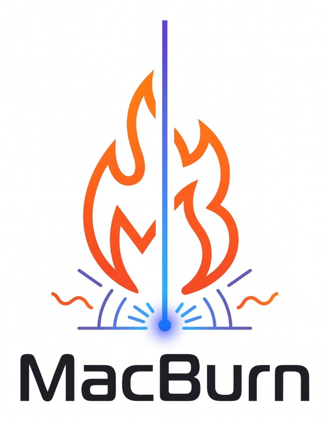

<p align="center"></p>

# MacBurn

Freie, native Laser-Software für macOS. Gestalten, vorbereiten und lasern mit GRBL-Diodenlasern.

- **Kern** in C++20 (`src/core`): Profile, Dokument, Geometrie, Job-Pipeline, GRBL-Treiber, AppController
- **Dünne Cocoa-Schicht** in Objective-C++ (`src/mac`): Fenster, Menüs, Zeichenfläche, generischer Inspektor
- **Profile** (`profiles/`): Maschinenbibliothek und Materialprofile als JSON, Prinzip Maschine → Material
- Referenzmaschine: Mecpow X3 Pro (10 W)
- Konzept und Release-Plan: [docs/Konzept.md](docs/Konzept.md)

> **Stand:** frühe Entwicklungsversion (v0.1 in Arbeit). Verbinden, Bewegen, Rahmen, Materialtest und mehrere
> Aufträge mit Laserstrahl sind am X3 Pro gut gelaufen; *Fortsetzen nach Abbruch* ist dort noch nicht erprobt. Bitte nur unter
> Aufsicht und mit Schutzbrille verwenden.

## Voraussetzungen

macOS 27, Xcode Command Line Tools, CMake ≥ 3.24.

## Bauen

```bash
cmake -S . -B build
cmake --build build -j
open build/MacBurn.app
```

## Tests

```bash
ctest --test-dir build --output-on-failure
```

Die Tests laufen ohne Fenster und ohne Hardware; die Gerätesteuerung wird gegen eine simulierte GRBL-Steuerung geprüft.

## Bedienung

### Vier Phasen

| Phase | Kurzbefehl | Wofür |
|---|---|---|
| **Gestalten** | ⌘1 | Formen importieren, anordnen, bearbeiten |
| **Vorbereiten** | ⌘2 | Absicht je Ebene, Werte aus dem Material, Brennvorschau mit Leerfahrten |
| **Lasern** | ⌘3 | Verbinden, Bewegen, Rahmen, Auftrag mit Startprüfung |
| **Materialtest** | ⌘4 | Testplatte statt Design brennen, Skala ablesen, Werte als ✓ speichern |

Der Materialtest ist eine eigene Phase: Solange sie gewählt ist, zeigt die Fläche die Testplatte, nicht das
Design. Wer zwischendurch zu einer anderen Phase wechselt, findet den Test beim Zurückkehren unverändert vor.

### Maschine → Material

Wie Drucker → Filament beim 3D-Druck: Oben links wählst du die Maschine, darunter das Material. Die Werte für
*Schneiden*, *Gravieren*, *Foto* und *Markieren* kommen aus dem Materialprofil. Jedes Material zeigt seine Herkunft:

| Status | Bedeutung |
|---|---|
| ✓ getestet | auf genau dieser Maschine eingemessen |
| ◇ Herstellerwert | aus der Anleitung des Herstellers |
| ≈ abgeleitet | aus der Leistungsklasse umgerechnet – Materialtest empfohlen |
| ✎ geändert | im Projekt angepasst |

### Startvorlage

MacBurn startet mit dem eigenen Logo als Laservorlage: ein Schild 76 × 96 mm (Ebene *Schnitt*) mit dem
gravierten Logo (Ebene *Gravur*). Solange nichts daran geändert ist, gilt sie nicht als ungesichert, und ein
SVG-Import ersetzt sie. Die Vorlage ist [examples/MacBurn-Logo.svg](examples/MacBurn-Logo.svg); sie entsteht mit
[tools/trace_logo.mm](tools/trace_logo.mm) aus dem Logo-Bild.

### SVG importieren

*Ablage › Importieren …* (⌘I), Datei auf die Fläche ziehen oder im Finder *Öffnen mit › MacBurn*.
Jede Farbe wird zu einer Ebene. Geschlossene Formen (auch gefüllte) werden **geschnitten** – Gravieren wählt man
bewusst über die Farbe Blau. Enthält eine Farbe offene Linien, wird sie nur markiert – MacBurn schneidet nie
unbeabsichtigt.
Texte in SVG-Dateien bitte vorher im Zeichenprogramm in Pfade umwandeln. Beispiele: [examples/schild.svg](examples/schild.svg),
[examples/test-30mm.svg](examples/test-30mm.svg) (kleiner Testauftrag, ca. 1:20 min).

### Zeichnen

Die Werkzeugleiste links auf der Zeichenfläche (oder die Taste, solange die Fläche aktiv ist):

| Werkzeug | Taste | Bedienung |
|---|---|---|
| Auswahl | V | auswählen, verschieben, Anfasser; auf leerer Fläche ziehen = Auswahlrechteck |
| Lasso | Q | frei um Objekte herumziehen (erfasst wird, was ganz innen liegt; ⇧ ergänzt); danach wieder Auswahl |
| Linie | L | ziehen; ⇧ = 45°-Schritte |
| Rechteck | R | ziehen; ⇧ = Quadrat; Eckenradius im Inspektor |
| Ellipse | E | ziehen; ⇧ = Kreis |
| Dreieck | D | von der Mitte aus ziehen; Richtung dreht, ⇧ = 15°-Schritte |
| Polygon | P | wie Dreieck; Eckenzahl im Inspektor |
| Stern | S | wie Dreieck; Zacken und Innenradius im Inspektor |
| Polylinie | N | Punkte klicken; Doppelklick oder ↩ beendet, Klick auf den Startpunkt schließt, Esc bricht ab |
| Text | T | klicken (Grundlinie beginnt dort) und lostippen |

**Genaue Maße:** Ist ein Werkzeug aktiv, zeigt der Inspektor seine Maße – X/Y und Breite/Höhe (Rechteck,
Ellipse, Eckenradius), Mittelpunkt, Durchmesser und Drehung (Dreieck, Polygon, Stern) bzw. Start, Länge und
Winkel (Linie). *Erstellen* oder ↩ legt die Form genau so an. Ein Klick auf die Fläche legt sie mit diesen Maßen
mittig an der Stelle an.

Neue Formen kommen in die links gewählte Ebene (in einem leeren Projekt wird eine Schnittebene angelegt)
und sind danach ausgewählt.

**Zahlenfelder rechnen mit:** Komma oder Punkt, `100/3`, `25+12,5`, `(10+2)*3`, Einheiten `mm`, `cm`, `in`, `pt`.
Angezeigt werden bis zu drei Nachkommastellen.

### Ebenen

Die Ebenenliste in der Seitenleiste ist die eine Stelle für Ebenen:

- **Klick auf eine Ebene:** Sie wird aktiv – rechts stehen ihre Einstellungen, neue Formen landen dort.
- **Formen auf eine Ebene ziehen:** Ausgewählte Formen auf der Zeichenfläche greifen und über der Ebene in der
  Liste loslassen. Die Formen bleiben, wo sie sind, und gehören dann zu dieser Ebene (ein Widerrufschritt).
- **„+“ neben *Ebenen*:** legt eine neue Ebene zum Schneiden, Gravieren oder Markieren an – zuerst in der festen
  Farbe (Rot, Blau, Grün), danach in weiteren Farben, etwa für einen zweiten Schnitt mit anderen Werten. Eine
  vorhandene Auswahl kommt gleich hinein.

Schneller über die Tastatur oder das Menü *Objekt › Farbe*:

| Farbe | Taste | Absicht neuer Ebenen |
|---|---|---|
| Rot | ⌥1 | Schneiden |
| Blau | ⌥2 | Gravieren |
| Grün | ⌥3 | Markieren |

Mit Auswahl kommen die Formen in die Ebene dieser Farbe – vorhandene Ebenen werden erkannt (z. B. „Rot“ aus
einem SVG oder „Schnitt“ aus der Startvorlage), fehlende angelegt, leer gewordene entfernt. Ohne Auswahl wählt die
Taste die Farbe für die nächsten gezeichneten Formen. Im Inspektor legt das Feld *Ebene* die Auswahl in jede
vorhandene Ebene.

### Text

Alle auf dem Mac installierten Schriften. Im Inspektor: Text (⌥↩ für eine neue Zeile), Schrift, Schnitt,
**Höhe der Großbuchstaben in mm**, Zeichen- und Zeilenabstand, Ausrichtung. Text kommt in eine Gravurebene
(gewählte Ebene, wenn sie graviert oder markiert; sonst die erste Gravurebene, notfalls neu angelegt).

Text bleibt bearbeitbar – auch nach Verschieben, Drehen, Skalieren, Spiegeln, Duplizieren und nach dem
Sichern. *In Pfade umwandeln* macht daraus normale Formen; beim Kombinieren geschieht das automatisch.

### Formen bearbeiten

- **Auswählen:** Klick auf Kontur oder Fläche, ⇧ für mehrere. Ein importiertes SVG ist ein Objekt.
- **Verschieben:** mit der Maus oder den Pfeiltasten.
- **Skalieren:** Anfasser am Auswahlrahmen – Ecken proportional, Kanten einachsig, ⇧ kehrt um.
  Oder X, Y, Breite, Höhe im Inspektor eingeben. Der **Bezugspunkt** (9-Punkt-Raster) legt fest, auf welchen
  Punkt sich X/Y beziehen und welcher Punkt beim Ändern der Größe stehen bleibt.
- **Drehen:** Dreh-Anfasser über der Auswahl (⇧ = 15°-Schritte), beliebiger Winkel im Inspektor, 90° links/rechts.
- **Neigen** in X und Y, **Spiegeln**, **auf der Fläche zentrieren**.
- **Ausrichten** links, mittig, rechts, oben, mittig, unten – ein Objekt an der Fläche, mehrere aneinander.
  **Verteilen** ab drei Objekten.
- **Kombinieren** (Menü *Objekt › Kombinieren*): Vereinen, Vorderes vom hinteren abziehen, Schnittmenge, Teilen.
  Jede Ebene bleibt dabei für sich – Schnittkonturen bleiben Schnittkonturen.
- **Versatz:** neue Kontur außen (+) oder innen (−), z. B. als Schneiderand um eine Gravur.
- **Gruppieren** und **Gruppierung aufheben** – importierte SVGs zerfallen in ihre ursprünglichen Elemente.
- Alles lässt sich widerrufen.

### Materialtest

Phase *Materialtest* (⌘4), *Laser › Material testen …* (oder in der Materialauswahl *Dieses Material testen …* / *Neues Material testen …*).
Statt eines Rasters aus Kästchen brennt MacBurn eine kleine Testplatte (ca. 83 × 31 mm, gut 3 Minuten):

- **Gravurstreifen:** Leistung steigt stufenlos (z. B. 5 → 100 %), darunter eine Skala 0–100.
- **Kontrollstreifen:** halbe Geschwindigkeit bei gleicher Energie – sieht er an derselben Stelle gleich aus,
  stimmt die Umrechnung; sonst die Stelle als Kontroll-Wert eintragen.
- **Schnitt-Leiter:** schmaler Streifen, Geschwindigkeit sinkt stufenlos; wo er herausfällt, schneidet es durch.

Ablauf: Kopf über eine freie Stelle fahren (linke untere Ecke der Platte), *Rahmen abfahren*, *Test lasern …*,
dann die Skalenwerte ablesen und eintragen. *Als Material speichern* legt ein Profil **✓ getestet** für diese
Maschine an (Schneiden mit 15 % Reserve). Das Profil enthält eine Leistungskurve: Wird im Projekt nur die
Geschwindigkeit geändert, passt MacBurn die Leistung so an, dass die Gravur gleich dunkel bleibt.

### Lasern

1. Laser per USB anschließen, einschalten (Netzteil an, Not-Aus gelöst), *Laser › Verbinden* (⌘K).
2. *Referenzfahrt*, dann Position wählen:
   - **Wie auf der Fläche:** Das Design wird genau dort gelasert, wo es auf der Arbeitsfläche liegt.
   - **Am Laserkopf:** Ein wählbarer Ankerpunkt des Designs (Standard: Mitte) liegt unter dem Kopf.
     Kopf mit den Pfeiltasten über das Werkstück fahren.
3. *Rahmen abfahren* (⌘R) – der Kopf fährt den Umriss ab, der Laser bleibt aus.
4. *Lasern …* → Startprüfung abhaken (Fokus, Luftpumpe, Schutzbrille, Aufsicht) → *Starten*.
5. **Esc** oder **⌘.** stoppt sofort: Die Steuerung wird zurückgesetzt, der Laser ist aus.

Die Zeitschätzung bildet die Bahnplanung von GRBL nach (Beschleunigung, Kurvenabweichung).
Leerfahrten und Rahmen laufen mit einer schonenden Fahrgeschwindigkeit aus dem Maschinenprofil
(X3 Pro: 3000 mm/min), weil der Eilgang im Test Schritte verloren hat.

### Fortsetzen nach Abbruch

Während eines Auftrags sichert MacBurn jede Sekunde, wo der Laser gerade arbeitet
(`~/Library/Application Support/MacBurn/resume/`). Bricht der Auftrag ab – Stromausfall, Spannungseinbruch,
Verbindungsabbruch oder Stopp –, erscheint unter *Lasern* der Abschnitt **Unterbrochener Auftrag**, auch nach
einem Neustart von MacBurn. Die Fläche zeigt in Orange, was noch fehlt.

1. Verbinden. Lief vor dem Auftrag eine **Referenzfahrt**, verlangt MacBurn jetzt wieder eine – danach stimmt
   die Position genau, auch wenn die Steuerung zwischendurch aus war.
2. *Rahmen des Rests abfahren* (Laser aus) zum Prüfen.
3. *Fortsetzen*: Der Laser fährt mit ausgeschaltetem Strahl zum Anfang der Kontur (Schneiden) bzw. der
   Zeile (Gravieren), die gerade lief, und macht von dort mit denselben Werten weiter.

Ohne Referenzfahrt vor dem Auftrag passt es nur, wenn die Steuerung nicht neu gestartet ist (z. B. nach einem
USB-Abbruch) und das Werkstück nicht bewegt wurde. Darum am besten vor längeren Aufträgen referenzieren.
An der Neubeginn-Stelle kann eine Kontur doppelt gebrannt werden; beim Gravieren ist dort evtl. ein Übergang
zu sehen. *Verwerfen* löscht den Sicherungspunkt.

### Projekte

*Ablage › Sichern* (⌘S) legt eine `.macburn`-Datei an: lesbares JSON mit Formen, Ebenen, Projekt-Änderungen,
Maschine, Material, Position und einer Kopie der Materialwerte. So öffnet sich ein Projekt auch auf einem Mac,
dem das Materialprofil fehlt. Doppelklick im Finder öffnet das Projekt. Ungesicherte Änderungen zeigt der Punkt
im Schließknopf; vor dem Schließen fragt MacBurn nach.

### Tastenkürzel

| Kürzel | Befehl |
|---|---|
| ⌘N / ⌘O / ⌘S / ⇧⌘S | Neu / Öffnen / Sichern / Sichern unter |
| ⌘I | SVG importieren |
| ⇧⌘E | G-Code exportieren |
| ⌘Z / ⇧⌘Z | Widerrufen / Wiederholen |
| ⌘A / ⇧⌘A | Alles auswählen / Auswahl aufheben |
| ⌘D | Duplizieren |
| ⌫ | Löschen |
| ⌘G / ⇧⌘G | Gruppieren / Gruppierung aufheben |
| ⌥1 / ⌥2 / ⌥3 | Farbe Rot (Schneiden) / Blau (Gravieren) / Grün (Markieren) |
| ← → ↑ ↓ | Auswahl um 1 mm verschieben (⇧: 10 mm); in *Lasern* verbunden: Kopf bewegen |
| V Q L R E D P S N T | Werkzeuge: Auswahl, Lasso, Linie, Rechteck, Ellipse, Dreieck, Polygon, Stern, Polylinie, Text |
| ↩ | Polylinie beenden |
| ⌘1 / ⌘2 / ⌘3 / ⌘4 | Gestalten / Vorbereiten / Lasern / Materialtest |
| ⌘K / ⇧⌘K | Laser verbinden / trennen |
| ⌥⌘H | Referenzfahrt |
| ⌘R | Rahmen abfahren |
| ⌥⌘L | Verbindungsverlauf |
| Esc / ⌘. | Stopp (bei laufendem Auftrag), sonst Zeichnen abbrechen bzw. Auswahl aufheben |

## Geräteprotokoll

*Hilfe › Geräteprotokoll anzeigen* öffnet `~/Library/Logs/MacBurn/Geraet.log`: Verbinden/Trennen, Start, Ende und
Abbruch von Aufträgen (mit Grund und Position), Alarme mit Position und aktiven Eingängen, Fehler mit der
betroffenen G-Code-Zeile, Zustandswechsel, Rahmen, Referenzfahrt, Pause und Stopp.

Bleibt die Steuerung still, warnt MacBurn nach 5 Sekunden und schreibt die zuletzt gesendeten und empfangenen
Zeilen ins Protokoll – dazu, ob der USB-Anschluss noch da ist. Während eines Auftrags wartet MacBurn bis zu
20 Sekunden; antwortet der Laser wieder, läuft der Auftrag weiter. Startet die Steuerung mitten im Auftrag neu
(z. B. Spannungseinbruch), bricht MacBurn mit dieser Meldung ab.

Während ein Auftrag läuft, verhindert MacBurn den Ruhezustand des Macs (der Bildschirm darf aus).
Schliefe der Mac ein, risse die USB-Verbindung ab und der Laser bliebe mitten im Auftrag stehen.
Den Deckel eines MacBooks im Akkubetrieb nicht zuklappen. Einschlafen und Aufwachen stehen im Protokoll.

## Verbindungsverlauf

*Laser › Verbindungsverlauf* (⌥⌘L) zeigt live, was zwischen MacBurn und dem Laser hin- und hergeht:
→ an den Laser (blau), ← vom Laser, Fehler und Alarme rot. Die Statusabfragen (fünfmal pro Sekunde) sind
ausgeblendet und lassen sich einblenden. Unten lassen sich Befehle von Hand senden (z. B. `$$`, `$I`, `$X`);
Pfeil hoch/runter holt frühere Befehle zurück. Während eines Auftrags gehen nur `!` (anhalten), `~`
(fortsetzen) und `?`. Das Fenster hält die letzten 5000 Zeilen; geschlossen kostet es nichts.

## Laser auslesen

`mbprobe` sendet nur Abfragen (`?`, `$I`, `$$`), bewegt nichts und schaltet den Laser nicht ein.
Ohne Argument listet es die USB-Anschlüsse.

```bash
./build/mbprobe
```

```bash
./build/mbprobe /dev/cu.wchusbserial120
```

## Projektaufbau

```
src/core/      C++-Kern (ohne Cocoa): app, device, document, geometry, io, job, profiles, render, util
src/mac/       dünne Cocoa-Schicht (.mm)
profiles/      Maschinenbibliothek und Materialprofile (JSON)
resources/     App-Symbol (MacBurn.icns)
examples/      Startvorlage und Beispieldateien
tests/         Kerntests
tools/         mbprobe, make_icon (App-Symbol), trace_logo (Startvorlage)
third_party/   Fremdbibliotheken, unverändert
docs/          Konzept, UI-Entwurf, Logo
```

### Logo, App-Symbol und Startvorlage neu erzeugen

Alles entsteht aus [docs/logo/MacBurn-Logo.jpg](docs/logo/MacBurn-Logo.jpg):

```bash
clang++ -std=c++20 -fobjc-arc -framework Cocoa tools/make_icon.mm -o build/make_icon
build/make_icon docs/logo/MacBurn-Logo.jpg resources
iconutil -c icns resources/MacBurn.iconset -o resources/MacBurn.icns
mv resources/MacBurn-Logo.png docs/logo/ && rm -r resources/MacBurn.iconset
```

```bash
clang++ -std=c++20 -O2 -fobjc-arc -framework Cocoa tools/trace_logo.mm -o build/trace_logo
build/trace_logo docs/logo/MacBurn-Logo.jpg examples/MacBurn-Logo.svg
```

## Beitragen

Neue Maschinen und Materialien sind als JSON-Dateien unter `profiles/` willkommen – bitte mit Quellenangabe
(Herstelleranleitung oder eigener Materialtest).

## Lizenz

MacBurn: GPL-3.0-or-later, siehe [LICENSE](LICENSE).

Verwendete Bibliotheken:

| Bibliothek | Version | Lizenz | Zweck |
|---|---|---|---|
| [Clipper2](https://github.com/AngusJohnson/Clipper2) | 2.0.1 | Boost Software License 1.0 | Boolesche Operationen, Versatz |
